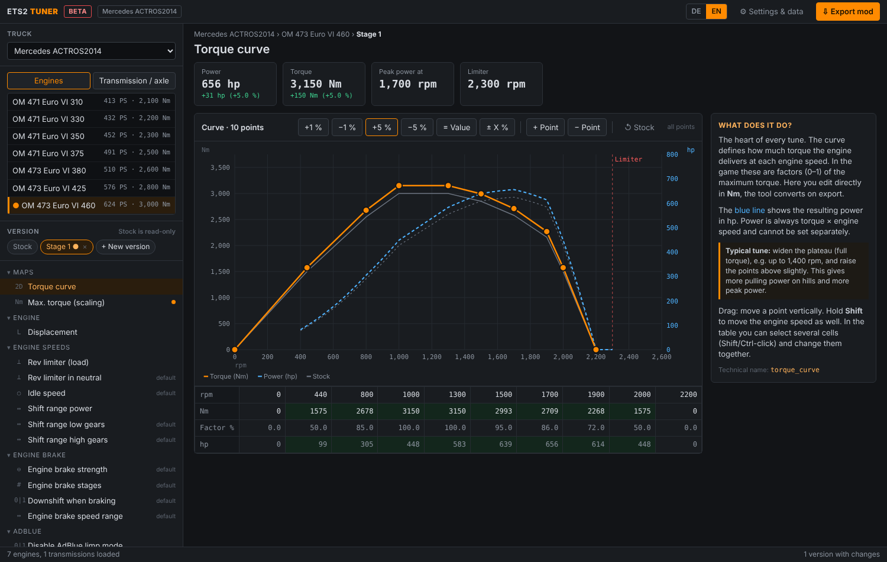

# ETS2 Tuner

**WinOLS-style engine & drivetrain tuning tool for Euro Truck Simulator 2**
*Chiptuning-Tool im WinOLS-Stil für Motoren und Antriebsstrang in Euro Truck Simulator 2*

> ⚠️ **Early beta.** Features may change and there may be bugs. Back up your profile before bigger changes.

ETS2 Tuner reads the original engine and transmission data straight from your game files and lets you edit them like a real tuning tool: draggable 2D maps, switches and single values, each with a short explanation. The result is exported as a ready-to-use `.scs` mod.

## Features

- **Reads the stock data automatically.** Detects your Steam installation and extracts `/def/vehicle/truck` from the base game and all DLCs.
- **WinOLS-like editor.** On the left: truck, component and versions (Stock, Stage 1, Stage 2 …), plus a map tree. On the right: an explanation for every value.
- **2D maps.** Edit the torque curve in Nm, with a live hp curve and the stock curve as comparison. Edit gear ratios, with km/h per gear. Drag points with the mouse, or select table cells and apply ±1 %, ±5 %, "= value" or "± X %".
- **Speed band tool.** Stretch the torque curve to a new end speed, redistribute points evenly, and move the rev limiter and shift ranges along with it.
- **Switches and values.**
  - Rev limiter, idle speed, shift ranges, engine brake (strength, stages, downshift), AdBlue limp mode.
  - Displacement, axle ratio, retarder.
  - Experimental fields for ETS2 1.61+.
  - Shop values (price, unlock level, display name), hidden by default.
- **Export.** Each version can be exported as a *new variant* (the original stays) or *overwrite original*. The hp/Nm display in the service menu is updated automatically. Save directly to your mod folder or download the file.
- **German and English UI**, switchable at any time.
- **No dependencies.** Runs on plain Python 3.8+, with a local web UI on `127.0.0.1`.

## Requirements

- Windows with Euro Truck Simulator 2 (Steam)
- [Python 3.8+](https://www.python.org/downloads/). During installation, tick *"Add python.exe to PATH"*.
- An `.scs` extractor. Recommended: [sk-zk/Extractor](https://github.com/sk-zk/Extractor/releases) (`extractor.exe`). The official SCS extractor works too, but is slower.

## Quick start

1. Download or clone this repository.
2. Put `extractor.exe` into the tool folder.
3. Double-click `Start.bat`. Your browser opens the tool.
4. *Settings & data* → **Extract game data**.
5. Select a truck → an engine or transmission → **+ New version** → edit.
6. **Export mod** → *Save to mod folder*. Then activate the mod in the game's mod manager.

Your work is saved automatically to `projekt.json`. After a game update, simply extract the game data again.

## How it works

ETS2 engines and transmissions are plain-text SII definitions (`accessory_engine_data`, `accessory_transmission_data`).
- **Reading:** the tool parses these files and resolves `@include` files, such as the sound definitions.
- **Writing:** it writes a new unit with only the changed attributes, so unknown or future attributes are preserved as they are.
- **Torque curve:** the curve is edited in absolute Nm and converted back to `torque` plus normalised `torque_curve` factors on export.

## Notes

- Singleplayer only. Engine mods are not allowed on TruckersMP.
- Fields under *Experimental (1.61+)* are based on community documentation and are not official.
- If a mod doesn't load, check `Documents\Euro Truck Simulator 2\game.log.txt`.

## Disclaimer

This is an unofficial fan project and is not affiliated with or endorsed by SCS Software. Euro Truck Simulator 2 and all truck brands are trademarks of their respective owners. No game files are included in this repository.

---

## Deutsch (Kurzfassung)

ETS2 Tuner liest die originalen Motor- und Getriebedaten aus deinem Spiel aus. Du bearbeitest sie wie in einem echten Tuning-Tool: Kennlinien per Maus, Schalter und Einzelwerte, jeweils mit kurzer Erklärung. Am Ende exportiert das Tool einen fertigen `.scs`-Mod. Die Bedienungsanleitung findest du in `LIESMICH.txt`.
